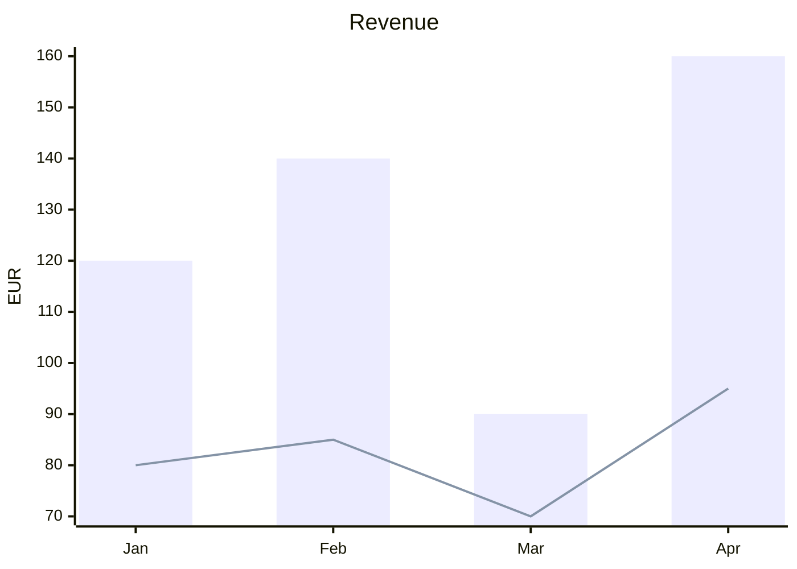
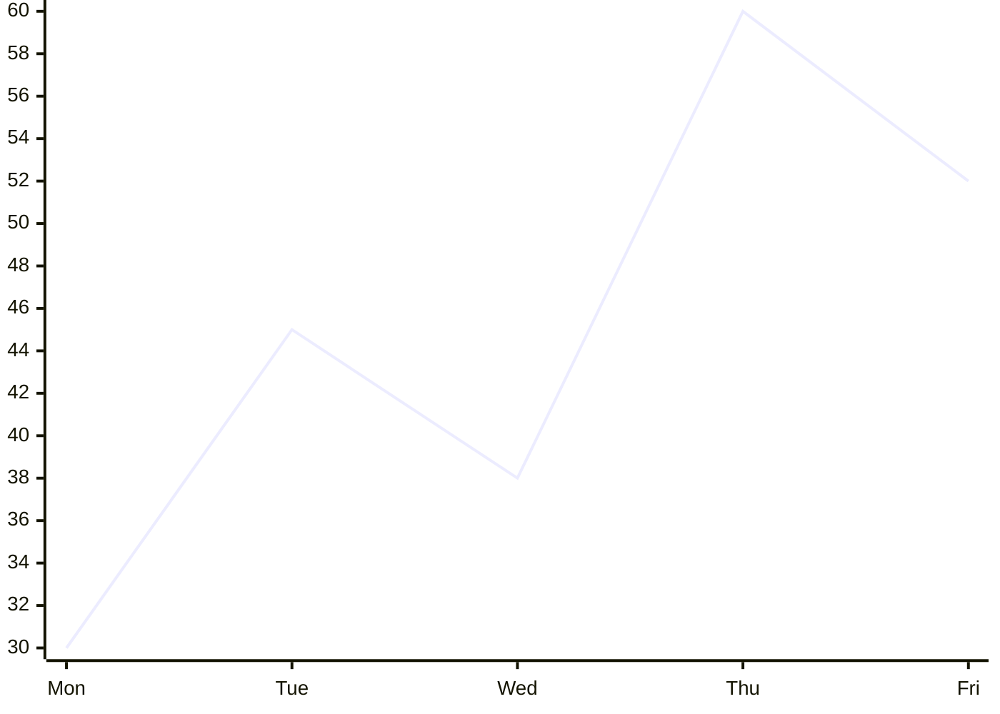
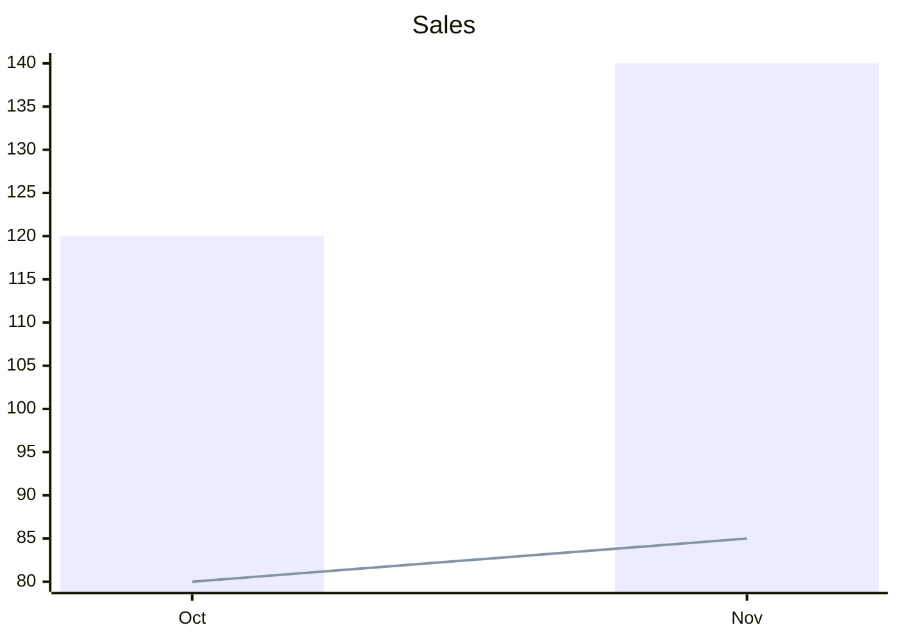

# Silverware Chart

Charts in your pages, written so other tools draw them too. A chart is a ` ```mermaid ` block, as Mermaid writes charts (tools that draw Mermaid can draw it as well); in SilverBullet it is drawn with [Chart.js](https://www.chartjs.org): more types, colors that follow your theme, and its data can come from a markdown table of your page, the chart changing as you edit the table. With [[Library/damesene/silverware-table|Silverware Table]] it can also draw a table you named, and the chart's numbers are written with your edits of the table.

## At a glance

A Mermaid chart, as Mermaid writes it:

````markdown

````

* **Bars and lines** over labels: `xychart-beta` (`xychart-beta horizontal` for bars across), a `title`, an `x-axis` of labels, a `y-axis` with its title and a range (`0 --> 200`), and a `bar` or `line` per series, its name in quotes.
* **A pie**: `pie title Pets`, then a line per slice: `"Dogs" : 386`.
* Any other Mermaid diagram (a flowchart) is left to what draws Mermaid in your space: SilverBullet's Mermaid library where it is installed, else it shows as code.

## More than Mermaid says

What Mermaid has no words for goes into its comments, one setting a line: `%% chart.<setting>: <value>`. Mermaid leaves them out, so the block still draws there as a plain chart.

````markdown

````

| Setting | What it does |
|---|---|
| `type` | The type of chart: `bar`, `line`, `area`, `scatter`, `pie`, `doughnut`, `polarArea`, `radar` (Mermaid itself draws bars, lines and pies) |
| `stacked` | `true`: the series stacked on each other |
| `kinds` | How each series is drawn, in their order: `bar`, `line`, `area`, `points` or `step` (Mermaid draws an area, points and steps as a line) |
| `smooth` | `true`: lines curved through their points |
| `colors` | The series' colors (a pie's slices'), comma separated: `#4e79a7, #f28e2b` |
| `legend` | Where the legend is: `top`, `bottom`, `left`, `right`, or `none` |
| `height` | The chart's height: `400px`, `20em` |
| `source`, `x`, `series` | The data from a table: see below |
| `where`, `rows` | Only some of the table's rows: see below |

A setting it does not know is kept as you wrote it.

## Data from a table

A chart may draw a markdown table instead of the numbers in its block: say which table with `source`, the column of the labels with `x` and the columns of the values with `series` (by their names as they show, or as SilverBullet's index keys them: `Unit price` or `unit_price`).

````markdown
| Month | Revenue | Cost |
|---|--:|--:|
| Oct | 120 | 80 |
| Nov | 140 | 85 |


````

| `source` | The table |
|---|---|
| `above` | the nearest table above the chart |
| `below` | the nearest table below it |
| `#Sales` | the first table in the section of the heading *Sales* (under its subheadings too, not past the next heading of its level); `[[Page]]#Sales` on another page |
| `sales` | the table you named *sales* with [[Library/damesene/silverware-table\|Silverware Table]] (the pencil in its ⋯ menu), `[[Page]]sales` on another page; needs Silverware Table |

* In SilverBullet the chart draws the table as it is: edit a cell and the chart changes.
* The numbers in the block are what other tools that draw Mermaid show. With Silverware Table, an edit of a table you make with it writes them anew in the same edit, so one Ctrl+Z takes back both.
* Where they are behind the table (you edited its markdown by hand, or Silverware Table is not installed), the chart says **Stale: update data** in its corner: click it to write the table's numbers into the block.
* The block's series keep their kind (`bar`, `line`) and their names, in the order of the `series` columns.
* **Only some rows**: `%% chart.where: Status = done` keeps the rows where the condition holds (a line each, every one must hold), written as spreadsheets write the conditions of `SUMIFS`: `= done` (or just `done`, any case), `<> done`, `> 100`, `<= 5`, `app*` and `?at` (wildcards), `=` (empty), `<>` (not empty). A number compares with cells that are numbers (`12,99 €` and `3 kg` are; `A1`, `Q1` and `Room 12` are text): `> 100` keeps no text. `%% chart.rows: first 10` or `last 12` then keeps the first or last so many of them. The settings' *Data* sets both: *Rows* and *Only where*.
* Rename a column or the table with Silverware Table and the chart follows: its `source`, `x` and `series` are written with the new names in the same edit (a series named as its column takes the new name too).
* A column the chart names that the table does not have (renamed in the markdown by hand) is said in the chart's place, with the table's columns to pick from: click one and it is written into the block.

## The chart's menu

Point at a chart and a small toolbar shows above its top left corner; its **⋯** opens the chart's menu:

* **Type**: every type of chart as a gallery (bars, stacked bars, horizontal bars, lines, areas, stacked areas, scatter, pie, doughnut, polar area, radar); click one and the chart is written so, every series drawn that way.
* **Settings…**: the chart's settings in a dialog, on tabs, each shown where the chart's type has it: *General* (title, height, legend, stacked, horizontal, smooth lines), *Data* for a chart of a table (the column of the labels; all rows, or the first or last so many; only the rows where conditions hold), *Axes* (the axes' titles, the y axis' range), *Series* (each series' color, name and how it is drawn among the others: *Bars*, *Line*, *Area*, *Points* or *Steps*; for a chart of a table every column of it, each switched on or off), *Slices* for a pie (each slice's color). Nothing is written until *Save*, then in one edit. Mermaid knows bars and lines (`bar "…" [ ]`, `line "…" [ ]`): an area, points and steps are a `line` there, their kinds said in `chart.kinds`.
* **Data**: the tables of the page the chart can draw (the table above it, below it, each first table under a heading, and with Silverware Table those you named). Pick one and the chart draws it at once (its first text column the labels, its columns of numbers the values), the settings opening at *Data* to change that. *No table* goes back to the block's own numbers.
* **Edit source**: the block's markdown, to edit it by hand.
* **Copy source**: the block's markdown on your clipboard.
* **Copy as image**: the chart as a picture on your clipboard (where the browser allows it: SilverBullet over https or on your own computer).
* **Reload**: the chart drawn anew, its table read again.

Every change is one edit of the block you can undo.

**Insert a chart**: the command **Silverware Chart: Insert chart** lists the tables of the page; pick one and a chart of it goes right under it (`source: above`). Type **/chart** where you write: pick a table the chart can name from there (the one above, below, under a heading, one you named with Silverware Table) or *An example of its own numbers*, and the chart goes there. Either is bars of the table's columns of numbers over its first other column; *Type* and *Settings…* change it.

## Settings

| Setting | Default | What it does |
|---|---|---|
| `silverware.chart.height` | `300px` | A chart's height where its block says none |
| `silverware.chart.modules.<name>.enabled` | `true` | Turns a part off (applies on reload): `mermaid` (charts written as Mermaid), `types` (the built-in types of charts), `settings` (the common settings of the settings dialog), `tables` (markdown tables as sources), `silverwareTable` (tables named by Silverware Table, and the chart's data written with the table's edits), `insert` (the command and `/chart`) |

## Custom formats

A chart may be written in a format of your own: a JS file of your space that reads a block into a chart and writes a chart back, given to `silverware.chart.defineFormats` from a `space-lua` block. A format's `read` gets the block's text and gives a chart (`{ type, labels, series = { { name, values } }, title, … }`), nothing where the block is not one of its charts, or `{ problem = "…" }`; `write` gets a chart (and the block as it was) and gives its text. A format of a built-in one's name takes its place.

```js
// Library/me/csv-chart.js: a ```csvchart block, its first line the series' names, then a label and values a line
export default {
  name: "csvChart",
  label: "CSV chart",
  languages: ["csvchart"],
  read(text) {
    const [head, ...rows] = text.trim().split("\n").map((line) => line.split(",").map((cell) => cell.trim()));
    if (!head) return undefined;
    return {
      type: "bar",
      labels: rows.map((row) => row[0]),
      series: head.slice(1).map((name, i) => ({ name, values: rows.map((row) => Number(row[i + 1])) })),
    };
  },
  write(chart) {
    const head = ["label", ...chart.series.map((s) => s.name ?? "")].join(", ");
    return [head, ...chart.labels.map((label, i) => [label, ...chart.series.map((s) => s.values[i])].join(", "))].join("\n");
  },
};
```

```lua
silverware.chart.defineFormats(js.importFromSpace("Library/me/csv-chart.js"))
```

A function given the helpers may stand in for the list (`function(helpers) return { … } end` in JS: `helpers.readMermaid`, `helpers.writeMermaid`, `helpers.listItems`). A mistake in a definition is shown in a notification; the other formats are defined.

## Implementation

```space-lua
-- priority: 50
-- Silverware Chart's Space Lua API, loaded before your scripts: silverware.chart.defineFormats, see "Custom formats"
silverware = silverware or {}
silverware.chart = silverware.chart or {}
if js and js.window then
  local silverwareChartJs = js.importFromSpace("Library/damesene/silverware-chart.js")
  -- Space Lua is loaded (again): the scripts' definitions replace those of before (kept until then)
  silverwareChartJs.resetDefinitions()
  --- Your own formats of charts, from a JS module of the space; a mistake is shown, the others are defined.
  --- @param definitions table a JS module's formats, e.g. js.importFromSpace("Library/me/csv-chart.js")
  --- @see Library/damesene/silverware-chart#Custom formats
  function silverware.chart.defineFormats(definitions)
    local problem = silverwareChartJs.defineFormats(definitions)
    if problem then
      editor.flashNotification(problem, "error")
    end
  end
else
  -- Space Lua without a window (nothing to draw): nothing to define
  function silverware.chart.defineFormats() end
end
```

```space-lua
-- priority: -10
-- (After the libraries of priority 0, SilverBullet's Mermaid among them: the code widgets defined here are the ones
-- used, and what drew a language before is kept to draw what is no chart)
config.defineCategory {
  name = "Silverware Chart",
  description = "Charts written as Mermaid, drawn with Chart.js.",
  priority = 3,
}

config.define("silverware.chart", {
  description = "Silverware Chart settings",
  type = "object",
  properties = {
    height = {
      type = "string",
      default = "300px",
      description = "A chart's height where its block says none (CSS: 300px, 20em).",
      ui = { category = "Silverware Chart", label = "Chart height", priority = 1 },
    },
    modules = {
      type = "object",
      additionalProperties = false,
      properties = {
        mermaid = { type = "object", additionalProperties = false, properties = { enabled = { type = "boolean", default = true, description = "Charts written as Mermaid (```mermaid blocks of xychart-beta and pie), which other Mermaid renderers can draw too.", ui = { category = "Silverware Chart", label = "Mermaid", priority = 0.9 } } } },
        types = { type = "object", additionalProperties = false, properties = { enabled = { type = "boolean", default = true, description = "The built-in types of charts: bar, line, area, scatter, pie, doughnut, polar area, radar.", ui = { category = "Silverware Chart", label = "Chart types", priority = 0.8 } } } },
        settings = { type = "object", additionalProperties = false, properties = { enabled = { type = "boolean", default = true, description = "The settings every chart has, in its settings dialog: title, height, legend, stacked, smooth lines, the axes, each series' name, color and how it is drawn.", ui = { category = "Silverware Chart", label = "Chart settings", priority = 0.75 } } } },
        tables = { type = "object", additionalProperties = false, properties = { enabled = { type = "boolean", default = true, description = "A markdown table as a chart's data, found by its place (above or below the chart, under a heading), followed as it is edited.", ui = { category = "Silverware Chart", label = "Tables as sources", priority = 0.7 } } } },
        silverwareTable = { type = "object", additionalProperties = false, properties = { enabled = { type = "boolean", default = true, description = "Where Silverware Table is installed: a table it named as a chart's data, and the chart's data written into its block with each edit of the table.", ui = { category = "Silverware Chart", label = "Silverware Table", priority = 0.6 } } } },
        insert = { type = "object", additionalProperties = false, properties = { enabled = { type = "boolean", default = true, description = "The command Silverware Chart: Insert chart (a chart under a table of the page) and the slash command /chart (a chart at the cursor), the table picked from a list.", ui = { category = "Silverware Chart", label = "Insert a chart", priority = 0.5 } } } },
      },
    },
  },
})

-- Silverware Chart only uses the public editor, space and config API (and Silverware Table's), handed over here
if js and js.window then
  local silverwareChartJs = js.importFromSpace("Library/damesene/silverware-chart.js")
  local bridge = {
    getText = editor.getText,
    getCurrentPage = editor.getCurrentPage,
    readPage = space.readPage,
    replaceRange = editor.replaceRange,
    getCursor = editor.getCursor,
    moveCursor = editor.moveCursor,
    flash = function(message, type)
      editor.flashNotification(message, type)
    end,
    filterBox = function(label, options)
      return editor.filterBox(label, options, "", "Type to find a table")
    end,
    getConfig = config.get,
  }
  -- Silverware Table's API, where it is installed (its API page has priority 50: defined before this block)
  if silverware.table and silverware.table.tables and silverware.table.onWrite then
    bridge.tables = silverware.table.tables
    bridge.onWrite = silverware.table.onWrite
  end
  silverwareChartJs.init(bridge)
  -- The commands and slash commands of the modules turned on
  for _, name in ipairs(silverwareChartJs.commandNames()) do
    command.define {
      name = name,
      run = function()
        silverwareChartJs.runCommand(name)
      end,
    }
  end
  for _, slash in ipairs(silverwareChartJs.slashCommandNames()) do
    local name = slash.name
    slashCommand.define {
      name = name,
      description = slash.description,
      run = function()
        silverwareChartJs.runSlashCommand(name)
      end,
    }
  end
  -- A code widget for each language a format reads; a block that is no chart goes to what drew that language before
  for _, language in ipairs(silverwareChartJs.languages()) do
    local before = config.get({ "codeWidgets", language }, nil)
    if before and before.silverwareChart then before = before.before end
    codeWidget.define {
      language = language,
      silverwareChart = true,
      before = before,
      render = function(body, pageName)
        local element = silverwareChartJs.render(language, body, pageName)
        if element then
          return widget.new { html = element, display = "block", cssClasses = { "swc-widget" } }
        end
        if before and before.render then
          return before.render(body, pageName)
        end
        return widget.new { html = silverwareChartJs.codeBlock(language, body), display = "block" }
      end,
    }
  end
  -- SilverBullet renders a code widget anew only when its text changes, not when what it read does: the charts shown
  -- follow their sources as the page is edited
  event.listen {
    name = "editor:pageModified",
    run = function()
      silverwareChartJs.pageModified(editor.getText(), editor.getCurrentPage())
    end,
  }
end
```

```space-style
/* Silverware Chart: a chart's box, and what shows where one cannot be drawn */
/* What Silverware Chart assumes about SilverBullet's DOM, all of it here: its own controls of a chart's block
   (its widget menu, .sb-widget-menu-bar: Edit source, Reload; the block's Copy button, .sb-code-copy-button in
   the block's first line, .cm-line > .sb-actions) left out, as the chart's toolbar has them; .swc-widget is the
   class the library page gives the chart's widget */
.swc-widget .sb-widget-menu-bar,
.cm-line:has(.swc-widget) > .sb-actions .sb-code-copy-button {
  display: none !important;
}

/* (An element of its own: swc-chart) */
.swc-chart {
  display: block;
  position: relative;
  width: 100%;
  box-sizing: border-box;
}

.swc-problem {
  height: auto !important;
  padding: 8px 12px;
  border: 1px dashed var(--editor-error-color, #d33);
  border-radius: 6px;
  color: var(--editor-error-color, #d33);
  font-size: 0.9em;
}

.swc-stale {
  position: absolute;
  top: 4px;
  left: 4px;
  padding: 2px 8px;
  border: 1px solid var(--editor-warning-color, #c80);
  border-radius: 4px;
  background: var(--root-background-color, #fff);
  color: var(--editor-warning-color, #c80);
  font-size: 12px;
  cursor: pointer;
  opacity: 0.85;
}

.swc-stale:hover {
  opacity: 1;
}

.swc-choices {
  margin-top: 6px;
  color: var(--root-color, inherit);
}

.swc-choice {
  margin: 2px 4px 2px 0;
  padding: 1px 8px;
  border: 1px solid var(--subtle-color, #999);
  border-radius: 4px;
  background: transparent;
  color: inherit;
  font: inherit;
  cursor: pointer;
}

.swc-choice:hover {
  border-color: var(--ui-accent-color, #4e79a7);
}

/* The toolbar of the chart hovered and its menu, floating in the page (Silverware Table's look) */
.swc-floating {
  position: fixed;
  z-index: 50;
  display: none !important;
  font-family: var(--ui-font, system-ui, sans-serif);
}

.swc-floating.swc-visible {
  display: flex !important;
}

.swc-bar {
  box-sizing: border-box;
  height: 26px;
  align-items: center;
  gap: 2px;
  padding: 1px 2px;
  font-size: 12px;
  color: var(--root-color);
  background: var(--root-background-color);
  border: 1px solid var(--button-border-color, rgba(128, 128, 128, 0.4));
  border-radius: 6px;
  box-shadow: 0 2px 8px rgba(0, 0, 0, 0.12);
}

.swc-bar button {
  display: inline-flex;
  align-items: center;
  padding: 2px 6px;
  color: inherit;
  background: none;
  border: 0;
  border-radius: 4px;
  cursor: pointer;
}

.swc-bar button:hover {
  background: color-mix(in srgb, var(--ui-accent-color) 16%, transparent);
}

.swc-menu {
  z-index: 60;
  flex-direction: column;
  min-width: 220px;
  max-width: 340px;
  padding: 4px;
  font-size: 13px;
  color: var(--root-color);
  background: var(--root-background-color);
  border: 1px solid var(--button-border-color, rgba(128, 128, 128, 0.4));
  border-radius: 8px;
  box-shadow: 0 6px 24px rgba(0, 0, 0, 0.18);
}

.swc-menu-title {
  display: grid;
  grid-template-columns: 22px 1fr 22px;
  align-items: center;
  gap: 4px;
  padding: 4px 4px 6px;
  font-size: 12px;
  font-weight: 600;
  text-align: center;
}

.swc-menu-back,
.swc-menu-close {
  display: inline-flex;
  align-items: center;
  justify-content: center;
  width: 22px;
  height: 22px;
  padding: 0;
  color: inherit;
  background: none;
  border: 0;
  border-radius: 4px;
  cursor: pointer;
  opacity: 0.7;
}

.swc-menu-back[hidden] {
  visibility: hidden;
  display: inline-flex;
}

.swc-menu-back:hover,
.swc-menu-close:hover {
  opacity: 1;
  background: color-mix(in srgb, var(--ui-accent-color) 14%, transparent);
}

.swc-menu-items {
  display: flex;
  flex-direction: column;
}

.swc-menu-item {
  display: flex;
  align-items: center;
  gap: 8px;
  padding: 5px 8px;
  text-align: left;
  font: inherit;
  color: inherit;
  background: none;
  border: 0;
  border-radius: 5px;
  cursor: pointer;
}

.swc-menu-item .swc-label {
  flex: 1;
}

.swc-menu-item.swc-menu-sub::after {
  content: "\203A";
  opacity: 0.6;
}

.swc-menu-item[aria-checked="true"] .swc-label::after,
.swc-menu-tile[aria-checked="true"] .swc-label::after {
  content: " \2713";
  color: var(--ui-accent-color);
}

.swc-menu-item[aria-disabled="true"],
.swc-menu-tile[aria-disabled="true"] {
  cursor: default;
  opacity: 0.45;
}

.swc-menu-item:not([aria-disabled="true"]):hover,
.swc-menu-tile:not([aria-disabled="true"]):hover,
.swc-menu-item:focus-visible,
.swc-menu-tile:focus-visible {
  background: color-mix(in srgb, var(--ui-accent-color) 14%, transparent);
  outline: none;
}

.swc-menu-tiles {
  display: grid;
  grid-template-columns: repeat(3, 1fr);
  gap: 2px;
}

.swc-menu-tile {
  display: flex;
  flex-direction: column;
  align-items: center;
  gap: 4px;
  padding: 8px 4px;
  font: inherit;
  font-size: 11px;
  color: inherit;
  background: none;
  border: 1px solid transparent;
  border-radius: 6px;
  cursor: pointer;
}

.swc-menu-tile[aria-checked="true"] {
  border-color: var(--ui-accent-color);
}

.swc-menu-tile svg {
  width: 22px;
  height: 22px;
}

.swc-icon {
  display: inline-flex;
}


.swc-menu-series {
  display: flex;
  align-items: center;
  gap: 6px;
}

.swc-menu-series input[type="color"] {
  width: 24px;
  height: 22px;
  padding: 0;
  border: 0;
  background: none;
  cursor: pointer;
}

.swc-menu-series input[type="text"],
.swc-menu-series select {
  min-width: 0;
  font: inherit;
  color: inherit;
  background: var(--root-background-color);
  border: 1px solid var(--button-border-color, rgba(128, 128, 128, 0.4));
  border-radius: 4px;
}

.swc-menu-series input[type="text"] {
  flex: 1;
  padding: 2px 4px;
}


/* The chart's settings dialog: the look of Silverware Tags' settings (shared/dialog.ts, its classes by the base swc-settings) */
.swc-settings-backdrop {
  position: fixed;
  inset: 0;
  top: var(--sw-view-top, 0);
  bottom: auto;
  height: var(--sw-view-height, 100%);
  z-index: 100;
  display: flex;
  align-items: center;
  justify-content: center;
  background: var(--modal-backdrop-color, rgba(0, 0, 0, 0.35));
  font-family: var(--ui-font, system-ui, sans-serif);
}
.swc-settings {
  --swc-settings-line: var(--button-border-color, rgba(128, 128, 128, 0.3));
  --swc-settings-card: color-mix(in srgb, var(--root-color) 4%, var(--root-background-color));
  /* Of one height whatever its tab shows (switching tabs moves nothing), 720px where the window has room;
     its body scrolls (a phone: the whole screen, below) */
  display: flex;
  flex-direction: column;
  /* (Its border within the height: SilverBullet sets no box-sizing, the playground border-box) */
  box-sizing: border-box;
  width: min(600px, calc(100vw - 24px));
  height: min(560px, calc(100vh - 32px));
  height: min(560px, calc(var(--sw-view-height, 100dvh) - 32px));
  color: var(--root-color);
  background: var(--root-background-color);
  border: 1px solid var(--swc-settings-line);
  border-radius: 10px;
  box-shadow: 0 12px 40px rgba(0, 0, 0, 0.28);
  font-size: 14px;
  overflow: hidden;
}
.swc-settings:focus {
  outline: none;
}
.swc-settings button {
  font: inherit;
  color: inherit;
  cursor: pointer;
}
.swc-settings-head {
  display: flex;
  align-items: flex-start;
  gap: 8px;
  padding: 14px 16px 8px;
}
.swc-settings-titles {
  flex: 1;
  min-width: 0;
}
.swc-settings-title {
  margin: 0;
  font-size: 17px;
  line-height: 1.3;
}
.swc-settings-subtitle {
  margin: 2px 0 0;
  font-size: 12px;
  opacity: 0.65;
}
.swc-settings-close {
  display: inline-flex;
  padding: 5px;
  background: none;
  border: 0;
  border-radius: 6px;
  opacity: 0.65;
}
.swc-settings-close:hover {
  opacity: 1;
  background: var(--swc-settings-card);
}
.swc-settings-close svg {
  width: 16px;
  height: 16px;
}
/* One row however many tabs: too wide for the dialog (a phone), it scrolls sideways */
.swc-settings-tabs {
  /* Never shrunk by a tall body (it scrolls sideways, so a column's flex would squeeze it: on a phone it slid under the body) */
  flex: none;
  display: flex;
  flex-wrap: nowrap;
  overflow-x: auto;
  scrollbar-width: none;
  gap: 2px;
  padding: 0 12px;
  border-bottom: 1px solid var(--swc-settings-line);
}
.swc-settings-tab {
  flex: none;
  white-space: nowrap;
  padding: 7px 10px;
  margin-bottom: -1px;
  background: none;
  border: 0;
  border-bottom: 2px solid transparent;
  opacity: 0.7;
}
.swc-settings-tab:hover {
  opacity: 1;
}
.swc-settings-tab[aria-selected="true"] {
  opacity: 1;
  font-weight: 600;
  border-bottom-color: var(--ui-accent-color);
}
.swc-settings-body {
  flex: 1 1 auto;
  min-height: 0;
  overflow-y: auto;
  padding: 4px 16px 12px;
}
.swc-settings-panel[hidden] {
  display: none;
}
.swc-settings-group {
  margin: 14px 2px 6px;
  font-size: 12px;
  font-weight: 600;
  opacity: 0.6;
}
.swc-settings-panel > .swc-settings-card:first-child {
  margin-top: 12px;
}
.swc-settings-card {
  background: var(--swc-settings-card);
  border: 1px solid var(--swc-settings-line);
  border-radius: 8px;
}
.swc-settings-card > :not(:first-child) {
  border-top: 1px solid var(--swc-settings-line);
}
.swc-settings-row {
  display: flex;
  align-items: center;
  gap: 12px;
  padding: 9px 12px;
}
.swc-settings-label {
  flex: 1;
  display: flex;
  flex-direction: column;
  gap: 1px;
  min-width: 0;
}
.swc-settings-module-name,
.swc-settings-name {
  font-weight: 500;
}
.swc-settings-hint {
  font-size: 12px;
  line-height: 1.35;
  opacity: 0.62;
}
.swc-settings-row select,
.swc-settings-row input[type="number"] {
  flex: none;
  font: inherit;
  color: inherit;
  background: var(--root-background-color);
  border: 1px solid var(--swc-settings-line);
  border-radius: 6px;
  padding: 4px 8px;
}
.swc-settings-row select {
  max-width: 55%;
}
.swc-settings-row input[type="number"] {
  width: 6.5em;
}
.swc-settings-row input.swc-settings-invalid {
  border-color: var(--danger-color, #c62828);
}
/* A switch: the checkbox (invisible, still focusable) drawn as a track and a knob */
.swc-settings-switch {
  position: relative;
  flex: none;
  width: 34px;
  height: 20px;
}
.swc-settings-switch input {
  position: absolute;
  inset: 0;
  width: 100%;
  height: 100%;
  margin: 0;
  opacity: 0;
  cursor: pointer;
}
.swc-settings-knob {
  position: absolute;
  inset: 0;
  border-radius: 10px;
  background: color-mix(in srgb, var(--root-color) 22%, var(--root-background-color));
  transition: background 0.15s;
  pointer-events: none;
}
.swc-settings-knob::after {
  content: "";
  position: absolute;
  top: 2px;
  left: 2px;
  width: 16px;
  height: 16px;
  border-radius: 50%;
  background: #fff;
  box-shadow: 0 1px 2px rgba(0, 0, 0, 0.3);
  transition: transform 0.15s;
}
.swc-settings-switch input:checked + .swc-settings-knob {
  background: var(--ui-accent-color);
}
.swc-settings-switch input:checked + .swc-settings-knob::after {
  transform: translateX(14px);
}
.swc-settings-switch input:focus-visible + .swc-settings-knob {
  outline: 2px solid var(--ui-accent-color);
  outline-offset: 2px;
}
.swc-settings-switch input:disabled + .swc-settings-knob {
  opacity: 0.5;
}
/* A module's own settings: under it, indented, while it is on */
.swc-settings-module-settings {
  margin: 0 12px 10px 24px;
  border-left: 2px solid var(--swc-settings-line);
}
.swc-settings-module-settings .swc-settings-row {
  padding: 6px 0 6px 12px;
}
.swc-settings-module-settings[hidden] {
  display: none;
}
.swc-settings-foot {
  display: flex;
  align-items: center;
  gap: 8px;
  padding: 10px 16px 12px;
  border-top: 1px solid var(--swc-settings-line);
}
.swc-settings-note {
  flex: 1;
  font-size: 12px;
  opacity: 0.75;
}
.swc-settings-cancel,
.swc-settings-save {
  padding: 6px 16px;
  border-radius: 6px;
  border: 1px solid var(--swc-settings-line);
  background: var(--root-background-color);
}
.swc-settings-save {
  color: #fff !important;
  background: var(--ui-accent-color);
  border-color: var(--ui-accent-color);
}
.swc-settings-save:disabled {
  opacity: 0.45;
  cursor: default;
}
@media (max-width: 480px), (pointer: coarse) and (max-height: 600px) {
  .swc-settings {
    width: 100vw;
    height: 100vh;
    height: var(--sw-view-height, 100dvh);
    max-height: none;
    border: 0;
    border-radius: 0;
  }
  .swc-settings-body {
    flex: 1 1 auto;
  }
  .swc-settings-tab {
    padding: 10px 12px;
  }
  .swc-settings-row {
    min-height: 44px;
  }
  .swc-settings-cancel,
  .swc-settings-save {
    padding: 10px 18px;
  }
  .swc-settings-row {
    flex-wrap: wrap;
  }
  /* The name keeps room to be read; a control that does not fit beside it goes under it, the row's width */
  .swc-settings-label {
    flex: 1 1 14em;
  }
  .swc-settings-row select {
    flex: 1 1 auto;
    max-width: 100%;
  }
  .swc-settings-row select,
  .swc-settings-row input[type="number"] {
    font-size: 16px;
  }
}

/* A row of each series (or slice): its number or label, then a control per setting */
.swc-settings-item {
  gap: 8px;
}
.swc-settings-item-name {
  flex: 0 0 auto;
  /* (One width for all: the controls after it under each other) */
  width: 5.5em;
  min-width: 1.5em;
  max-width: 8em;
  overflow: hidden;
  text-overflow: ellipsis;
  white-space: nowrap;
  font-size: 12px;
  opacity: 0.65;
}
.swc-settings-item input[type="text"] {
  flex: 1;
  min-width: 0;
}
.swc-settings-item input[type="radio"] {
  flex: none;
  margin: 0 8px;
  accent-color: var(--ui-accent-color);
}
.swc-settings-row input[type="text"] {
  font: inherit;
  color: inherit;
  background: var(--root-background-color);
  border: 1px solid var(--swc-settings-line);
  border-radius: 6px;
  padding: 4px 8px;
}
.swc-settings-row input[type="color"] {
  flex: none;
  width: 28px;
  height: 24px;
  padding: 0;
  border: 0;
  background: none;
  cursor: pointer;
}
.swc-settings-row :disabled {
  opacity: 0.5;
  cursor: default;
}

/* The settings' conditions: a row each, a column, an operator, a value and ×, then + another */
.swc-settings-row-wide {
  flex-wrap: wrap;
}
.swc-settings-conditions {
  flex: 1 1 100%;
  display: flex;
  flex-direction: column;
  gap: 6px;
}
.swc-settings-conditions > div {
  display: flex;
  flex-direction: column;
  gap: 6px;
}
.swc-settings-condition {
  display: flex;
  align-items: center;
  gap: 6px;
}
.swc-settings-condition select,
.swc-settings-condition input {
  min-width: 0;
  font: inherit;
  color: inherit;
  background: var(--root-background-color);
  border: 1px solid var(--swc-settings-line);
  border-radius: 6px;
  padding: 3px 6px;
}
.swc-settings-condition input {
  flex: 1;
}
.swc-settings-remove,
.swc-settings-add {
  padding: 3px 8px;
  background: none;
  border: 0;
  border-radius: 6px;
  opacity: 0.75;
}
.swc-settings-add {
  align-self: flex-start;
  font-size: 12px;
}
.swc-settings-remove:hover,
.swc-settings-add:hover {
  opacity: 1;
  background: var(--swc-settings-card);
}

.swc-code {
  margin: 0;
  white-space: pre-wrap;
}
```
