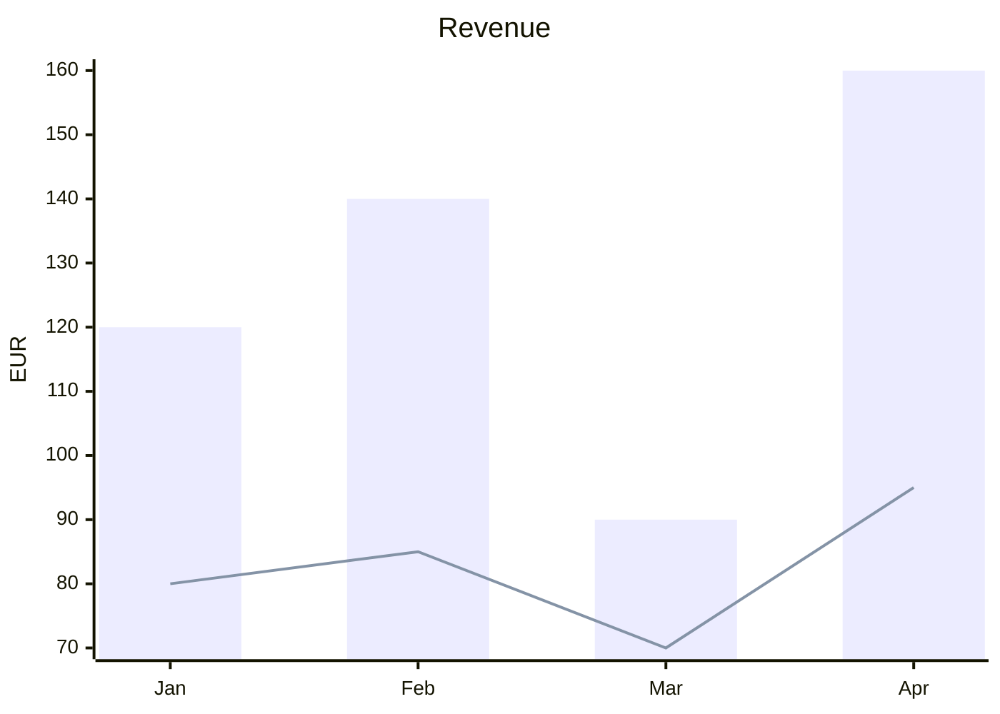
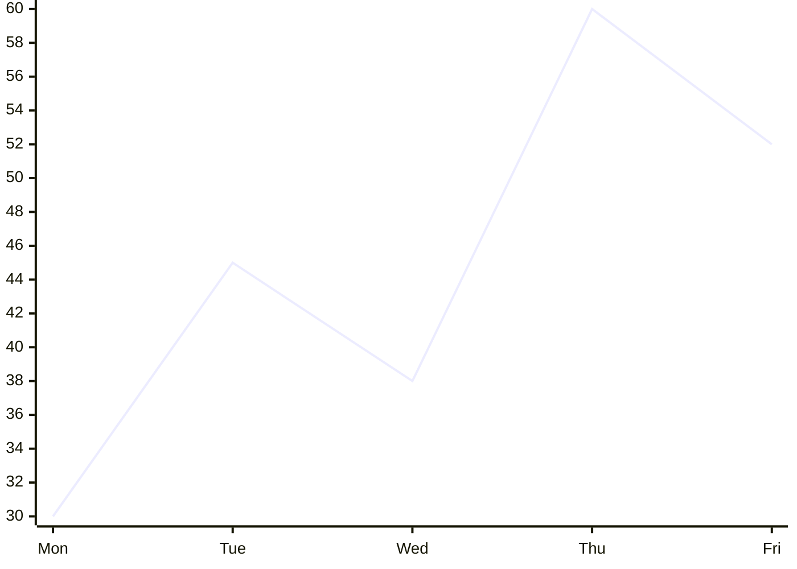
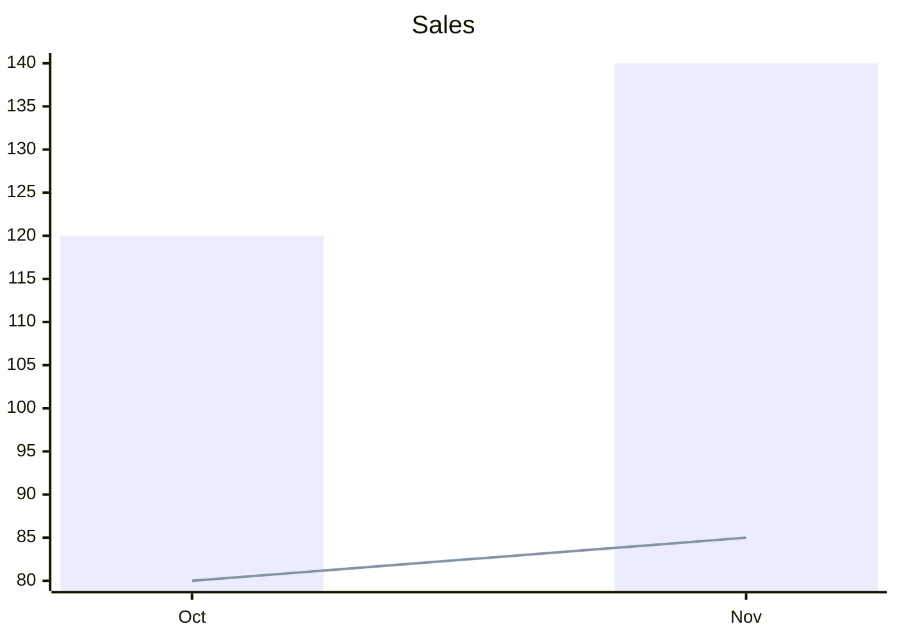

# Silverware Chart

Charts in your pages, written so other tools draw them too. A chart is a ` ```mermaid ` block, as Mermaid writes charts (tools that draw Mermaid can draw it as well); in SilverBullet it is drawn with [Chart.js](https://www.chartjs.org): more types, colors that follow your theme, and its data can come from a markdown table of your page, the chart changing as you edit the table. With [[Library/damesene/silverware-table|Silverware Table]] it can also draw a table you named, and the chart's numbers are written with your edits of the table.

## At a glance

A Mermaid chart, as Mermaid writes it:

````markdown

````

* **Bars and lines** over labels: `xychart-beta` (`xychart-beta horizontal` for bars across), a `title`, an `x-axis` of labels, a `y-axis` with its title and a range (`0 --> 200`), and a `bar` or `line` per series, its name in quotes.
* **A pie**: `pie title Pets`, then a line per slice: `"Dogs" : 386`.
* Any other Mermaid diagram (a flowchart) is left to what draws Mermaid in your space: SilverBullet's Mermaid library where it is installed, else it shows as code.

## More than Mermaid says

What Mermaid has no words for goes into its comments, one setting a line: `%% chart.<setting>: <value>`. Mermaid leaves them out, so the block still draws there as a plain chart.

````markdown

````

| Setting | What it does |
|---|---|
| `type` | The type of chart: `bar`, `line`, `area`, `scatter`, `pie`, `doughnut`, `polar`, `radar` (Mermaid itself draws bars, lines and pies) |
| `stacked` | `true`: the series stacked on each other |
| `kinds` | How each series is drawn, in their order: `bar`, `line`, `area`, `point` or `step` (Mermaid draws an area, points and steps as a line) |
| `smooth` | `true`: lines curved through their points |
| `colors` | The series' colors (a pie's slices'), comma separated: `#4e79a7, #f28e2b` |
| `legend` | Where the legend is: `top`, `bottom`, `left`, `right`, or `none` |
| `height` | The chart's height: `400px`, `20em` |
| `yFrom`, `yTo` | One end of the y axis alone: `%% chart.yFrom: 0` starts it at 0. Both ends go where Mermaid has them, `y-axis "EUR" 0 --> 200`; Mermaid takes no range with one end (it would be its syntax error) |
| `xFrom`, `xTo` | The x axis' range of a scatter chart (its x axis has numbers; Mermaid's has the labels there) |
| `source`, `labels`, `series` | The data from a table: see below |
| `where`, `rows` | Only some of the table's rows: see below |

A setting it does not know is kept as you wrote it.

## Data from a table

A chart may draw a markdown table instead of the numbers in its block: say which table with `source`, the column of the labels with `labels` and the columns of the values with `series` (by their names as they show, or as SilverBullet's index keys them: `Unit price` or `unit_price`).

````markdown
| Month | Revenue | Cost |
|---|--:|--:|
| Oct | 120 | 80 |
| Nov | 140 | 85 |


````

| `source` | The table |
|---|---|
| `above` | the nearest table above the chart |
| `below` | the nearest table below it |
| `#Sales` | the first table in the section of the heading *Sales* (under its subheadings too, not past the next heading of its level); `[[Page#Sales]]` on another page, as SilverBullet links to a heading |
| `sales` | the table you named *sales* with [[Library/damesene/silverware-table\|Silverware Table]] (the pencil in its ⋯ menu), `[[Page]]sales` on another page, as formulas name it; needs Silverware Table. A table named `above` or `below` is not found so: those words are the places |

* In SilverBullet the chart draws the table as it is: edit a cell and the chart changes.
* The numbers in the block are what other tools that draw Mermaid show. With Silverware Table, an edit of a table you make with it writes them anew in the same edit, so one Ctrl+Z takes back both.
* Where they are behind the table (you edited its markdown by hand, or Silverware Table is not installed), the chart says **Stale: update data** in its corner: click it to write the table's numbers into the block.
* The block's series keep their kind (`bar`, `line`) and their names, in the order of the `series` columns.
* **Only some rows**: `%% chart.where: Status = done` keeps the rows where the condition holds (a line each, every one must hold), written as spreadsheets write the conditions of `SUMIFS`: `= done` (or just `done`, any case), `<> done`, `> 100`, `<= 5`, `app*` and `?at` (wildcards), `=` (empty), `<>` (not empty). A number compares with cells that are numbers (`12,99 €` and `3 kg` are; `A1`, `Q1` and `Room 12` are text): `> 100` keeps no text. `%% chart.rows: first 10` or `last 12` then keeps the first or last so many of them. The settings' *Data* sets both: *Rows* and *Only where*.
* Rename a column or the table with Silverware Table and the chart follows: its `source`, `labels` and `series` are written with the new names in the same edit (a series named as its column takes the new name too).
* A column the chart names that the table does not have (renamed in the markdown by hand) is said in the chart's place, with the table's columns to pick from: click one and it is written into the block.

## The chart's menu

Point at a chart and a small toolbar shows above its top right corner; its **⋯** opens the chart's menu:

* **Type**: every type of chart as a gallery (bars, stacked bars, horizontal bars, lines, areas, stacked areas, scatter, pie, doughnut, polar area, radar); click one and the chart is written so, every series drawn that way.
* **Settings…**: the chart's settings in a dialog, on tabs, each shown where the chart's type has it: *General* (title, height, legend, stacked, horizontal, smooth lines), *Data* for a chart of a table (the column of the labels; all rows, or the first or last so many; only the rows where conditions hold), *Axes* (the axes' titles, the y axis' range, a scatter's x axis' range), *Series* (each series' color, name and how it is drawn among the others: *Bars*, *Line*, *Area*, *Points* or *Steps*; for a chart of a table every column of it, each switched on or off), *Slices* for a pie (each slice's color). Nothing is written until *Save*, then in one edit. Mermaid knows bars and lines (`bar "…" [ ]`, `line "…" [ ]`): an area, points and steps are a `line` there, their kinds said in `chart.kinds`.
* **Data**: the tables of the page the chart can draw (the table above it, below it, each first table under a heading, and with Silverware Table those you named). Pick one and the chart draws it at once (its first text column the labels, its columns of numbers the values), the settings opening at *Data* to change that. *No table* goes back to the block's own numbers.
* **Edit source**: the block's markdown, to edit it by hand.
* **Copy source**: the block's markdown on your clipboard.
* **Copy as image**: the chart as a picture on your clipboard (where the browser allows it: SilverBullet over https or on your own computer).
* **Reload**: the chart drawn anew, its table read again.

Every change is one edit of the block you can undo.

**Insert a chart**: the command **Silverware Chart: Insert chart** lists the tables of the page; pick one and a chart of it goes right under it (`source: above`). Type **/chart** where you write: pick a table the chart can name from there (the one above, below, under a heading, one you named with Silverware Table) or *An example of its own numbers*, and the chart goes there. Either is bars of the table's columns of numbers over its first other column; *Type* and *Settings…* change it.

## Settings

| Setting | Default | What it does |
|---|---|---|
| `silverware.chart.height` | `300px` | A chart's height where its block says none |
| `silverware.chart.modules.<name>.enabled` | `true` | Turns a part off (applies on reload): `mermaid` (charts written as Mermaid), `types` (the built-in types of charts), `settings` (the common settings of the settings dialog), `tables` (markdown tables as sources), `silverwareTable` (tables named by Silverware Table, and the chart's data written with the table's edits), `insert` (the command and `/chart`) |

## Custom formats

A chart may be written in a format of your own: a JS file of your space that reads a block into a chart and writes a chart back, given to `silverware.chart.defineFormats` from a `space-lua` block. A format's `read` gets the block's text and gives a chart (`{ type, labels, series = { { name, values } }, title, … }`), nothing where the block is not one of its charts, or `{ problem = "…" }`; `write` gets a chart (and the block as it was) and gives its text. A format of a built-in one's name takes its place.

```js
// Library/me/csv-chart.js: a ```csvchart block, its first line the series' names, then a label and values a line
export default {
  name: "csvChart",
  label: "CSV chart",
  languages: ["csvchart"],
  read(text) {
    const [head, ...rows] = text.trim().split("\n").map((line) => line.split(",").map((cell) => cell.trim()));
    if (!head) return undefined;
    return {
      type: "bar",
      labels: rows.map((row) => row[0]),
      series: head.slice(1).map((name, i) => ({ name, values: rows.map((row) => Number(row[i + 1])) })),
    };
  },
  write(chart) {
    const head = ["label", ...chart.series.map((s) => s.name ?? "")].join(", ");
    return [head, ...chart.labels.map((label, i) => [label, ...chart.series.map((s) => s.values[i])].join(", "))].join("\n");
  },
};
```

```lua
silverware.chart.defineFormats(js.importFromSpace("Library/me/csv-chart.js"))
```

A function given the helpers may stand in for the list (`function(helpers) return { … } end` in JS: `helpers.readMermaid`, `helpers.writeMermaid`, `helpers.listItems`). A mistake in a definition is shown in a notification; the other formats are defined.

## Implementation

Silverware Chart is started by [[Library/damesene/silverware-chart-init]] (its settings, code widgets and commands), its Space Lua API is [[Library/damesene/silverware-chart-api]] and its look [[Library/damesene/silverware-chart-style]]. All three are installed with this page.
