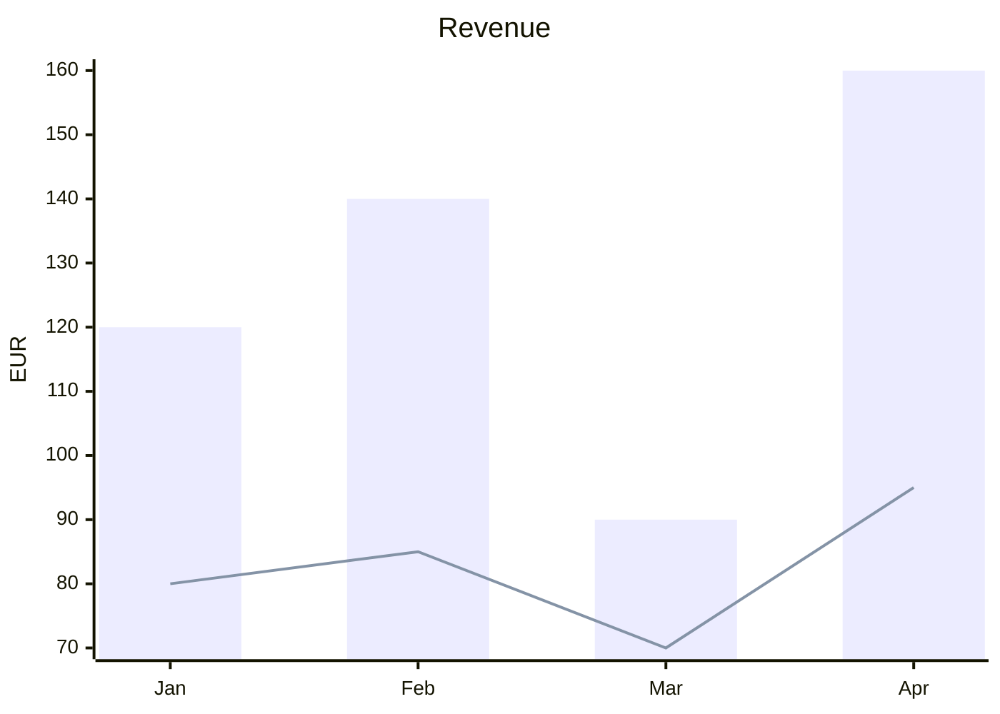
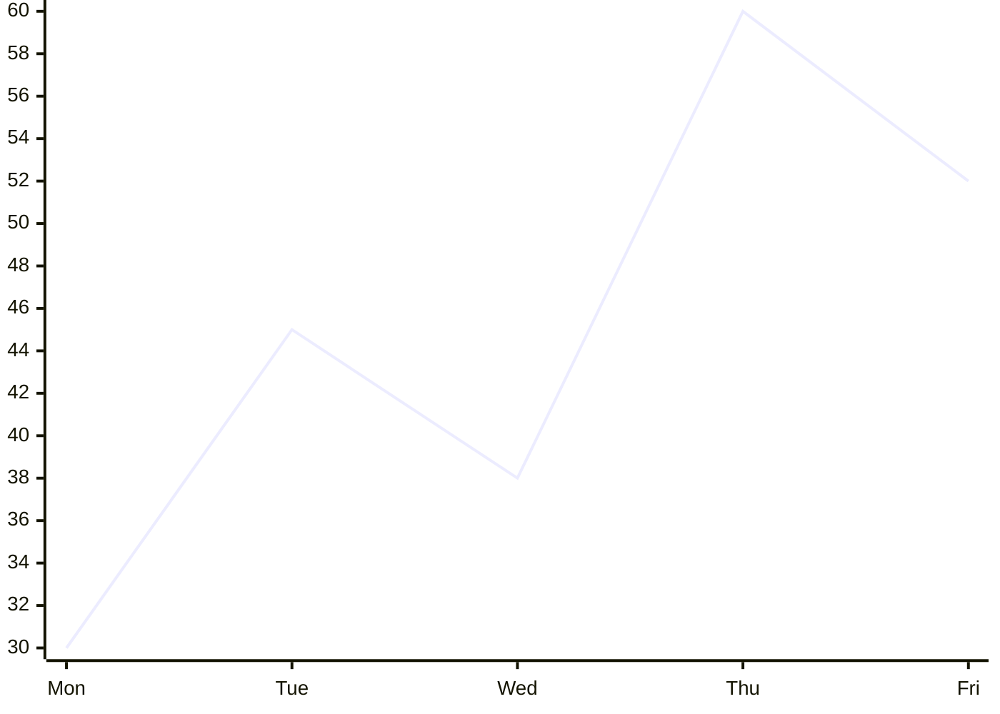
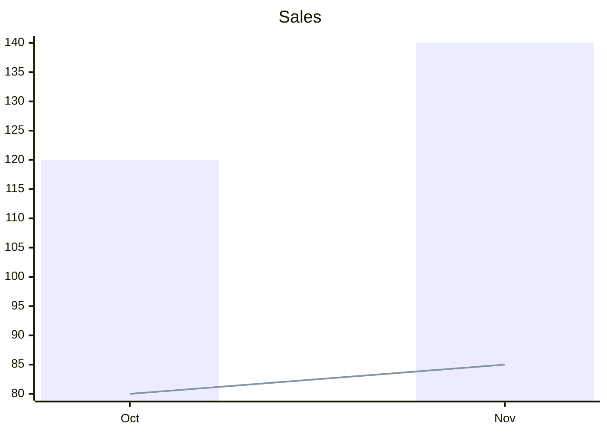

# Silverware Chart

Charts in your pages, written so other tools draw them too. A chart is a ` ```mermaid ` block, as Mermaid writes charts (GitHub and other Mermaid renderers draw it as well); in SilverBullet it is drawn with [Chart.js](https://www.chartjs.org): more types, colors that follow your theme, and its data can come from a table of [[Library/damesene/silverware-table|Silverware Table]], the chart changing as you edit the table.

## At a glance

A Mermaid chart, as Mermaid writes it:

````markdown

````

* **Bars and lines** over labels: `xychart-beta` (`xychart-beta horizontal` for bars across), a `title`, an `x-axis` of labels, a `y-axis` with its title and a range (`0 --> 200`), and a `bar` or `line` per series, its name in quotes.
* **A pie**: `pie title Pets`, then a line per slice: `"Dogs" : 386`.
* Any other Mermaid diagram (a flowchart) is left to what draws Mermaid in your space: SilverBullet's Mermaid library where it is installed, else it shows as code.

## More than Mermaid says

What Mermaid has no words for goes into its comments, one setting a line: `%% chart.<setting>: <value>`. Mermaid leaves them out, so the block still draws there as a plain chart.

````markdown

````

| Setting | What it does |
|---|---|
| `type` | The type of chart: `bar`, `line`, `area`, `scatter`, `pie`, `doughnut`, `polarArea`, `radar` (Mermaid itself draws bars, lines and pies) |
| `stacked` | `true`: the series stacked on each other |
| `smooth` | `true`: lines curved through their points |
| `colors` | The series' colors (a pie's slices'), comma separated: `#4e79a7, #f28e2b` |
| `legend` | Where the legend is: `top`, `bottom`, `left`, `right`, or `none` |
| `height` | The chart's height: `400px`, `20em` |
| `source`, `x`, `series` | The data from a table: see below |

A setting it does not know is kept as you wrote it.

## Data from a table

Name a table with Silverware Table (the pencil in its ⋯ menu), then say it in the chart: `source` the table's name (`[[Page]]sales` for a table on another page), `x` the column of the labels, `series` the columns of the values, by their names as formulas write them.

````markdown
| Month | Revenue | Cost |
|---|--:|--:|
| Oct | 120 | 80 |
| Nov | 140 | 85 |
| <meta core.table core.name='sales'> |


````

In SilverBullet the chart draws the table as it is: edit a cell and the chart changes. The numbers in the block are what other tools draw; keep them as they are or update them when you like. The block's series keep their kind (`bar`, `line`) and their names in the table's columns' order.

## Settings

| Setting | Default | What it does |
|---|---|---|
| `silverware.chart.height` | `300px` | A chart's height where its block says none |
| `silverware.chart.modules.<name>.enabled` | `true` | Turns a part off (applies on reload): `mermaid` (charts written as Mermaid), `types` (the built-in types of charts), `tables` (tables as sources) |

## Custom formats

A chart may be written in a format of your own: a JS file of your space that reads a block into a chart and writes a chart back, given to `silverware.chart.defineFormats` from a `space-lua` block. A format's `read` gets the block's text and gives a chart (`{ type, labels, series = { { name, values } }, title, … }`), nothing where the block is not one of its charts, or `{ problem = "…" }`; `write` gets a chart (and the block as it was) and gives its text. A format of a built-in one's name takes its place.

```js
// Library/me/csv-chart.js: a ```csvchart block, its first line the series' names, then a label and values a line
export default {
  name: "csvChart",
  label: "CSV chart",
  languages: ["csvchart"],
  read(text) {
    const [head, ...rows] = text.trim().split("\n").map((line) => line.split(",").map((cell) => cell.trim()));
    if (!head) return undefined;
    return {
      type: "bar",
      labels: rows.map((row) => row[0]),
      series: head.slice(1).map((name, i) => ({ name, values: rows.map((row) => Number(row[i + 1])) })),
    };
  },
  write(chart) {
    const head = ["label", ...chart.series.map((s) => s.name ?? "")].join(", ");
    return [head, ...chart.labels.map((label, i) => [label, ...chart.series.map((s) => s.values[i])].join(", "))].join("\n");
  },
};
```

```lua
silverware.chart.defineFormats(js.importFromSpace("Library/me/csv-chart.js"))
```

A function given the helpers may stand in for the list (`function(helpers) return { … } end` in JS: `helpers.readMermaid`, `helpers.writeMermaid`, `helpers.listItems`). A mistake in a definition is shown in a notification; the other formats are defined.

## Implementation

```space-lua
-- priority: 50
-- Silverware Chart's Space Lua API, loaded before your scripts: silverware.chart.defineFormats, see "Custom formats"
silverware = silverware or {}
silverware.chart = silverware.chart or {}
if js and js.window then
  local silverwareChartJs = js.importFromSpace("Library/damesene/silverware-chart.js")
  -- Space Lua is loaded (again): the scripts' definitions replace those of before (kept until then)
  silverwareChartJs.resetDefinitions()
  --- Your own formats of charts, from a JS module of the space; a mistake is shown, the others are defined.
  --- @param definitions table a JS module's formats, e.g. js.importFromSpace("Library/me/csv-chart.js")
  --- @see Library/damesene/silverware-chart#Custom formats
  function silverware.chart.defineFormats(definitions)
    local problem = silverwareChartJs.defineFormats(definitions)
    if problem then
      editor.flashNotification(problem, "error")
    end
  end
else
  -- Space Lua without a window (nothing to draw): nothing to define
  function silverware.chart.defineFormats() end
end
```

```space-lua
-- priority: -10
-- (After the libraries of priority 0, SilverBullet's Mermaid among them: the code widgets defined here are the ones
-- used, and what drew a language before is kept to draw what is no chart)
config.defineCategory {
  name = "Silverware Chart",
  description = "Charts written as Mermaid, drawn with Chart.js.",
  priority = 3,
}

config.define("silverware.chart", {
  description = "Silverware Chart settings",
  type = "object",
  properties = {
    height = {
      type = "string",
      default = "300px",
      description = "A chart's height where its block says none (CSS: 300px, 20em).",
      ui = { category = "Silverware Chart", label = "Chart height", priority = 1 },
    },
    modules = {
      type = "object",
      additionalProperties = false,
      properties = {
        mermaid = { type = "object", additionalProperties = false, properties = { enabled = { type = "boolean", default = true, description = "Charts written as Mermaid (```mermaid blocks of xychart-beta and pie), which GitHub and other Mermaid renderers draw too.", ui = { category = "Silverware Chart", label = "Mermaid", priority = 0.9 } } } },
        types = { type = "object", additionalProperties = false, properties = { enabled = { type = "boolean", default = true, description = "The built-in types of charts: bar, line, area, scatter, pie, doughnut, polar area, radar.", ui = { category = "Silverware Chart", label = "Chart types", priority = 0.8 } } } },
        tables = { type = "object", additionalProperties = false, properties = { enabled = { type = "boolean", default = true, description = "A named table of Silverware Table as a chart's data, followed as the table is edited.", ui = { category = "Silverware Chart", label = "Tables as sources", priority = 0.7 } } } },
      },
    },
  },
})

-- Silverware Chart only uses the public editor, space and config API (and Silverware Table's), handed over here
if js and js.window then
  local silverwareChartJs = js.importFromSpace("Library/damesene/silverware-chart.js")
  local bridge = {
    getText = editor.getText,
    getCurrentPage = editor.getCurrentPage,
    readPage = space.readPage,
    getConfig = config.get,
  }
  if silverware.table and silverware.table.evaluate then
    bridge.evaluate = function(formula, text, page)
      return silverware.table.evaluate(formula, text, page)
    end
  end
  silverwareChartJs.init(bridge)
  -- A code widget for each language a format reads; a block that is no chart goes to what drew that language before
  for _, language in ipairs(silverwareChartJs.languages()) do
    local before = config.get({ "codeWidgets", language }, nil)
    if before and before.silverwareChart then before = before.before end
    codeWidget.define {
      language = language,
      silverwareChart = true,
      before = before,
      render = function(body, pageName)
        local element = silverwareChartJs.render(language, body, pageName)
        if element then
          return widget.new { html = element, display = "block", cssClasses = { "swc-widget" } }
        end
        if before and before.render then
          return before.render(body, pageName)
        end
        return widget.new { html = silverwareChartJs.codeBlock(language, body), display = "block" }
      end,
    }
  end
  -- SilverBullet renders a code widget anew only when its text changes, not when what it read does: the charts shown
  -- follow their sources as the page is edited
  event.listen {
    name = "editor:pageModified",
    run = function()
      silverwareChartJs.pageModified(editor.getText(), editor.getCurrentPage())
    end,
  }
end
```

```space-style
/* Silverware Chart: a chart's box, and what shows where one cannot be drawn */
.swc-chart {
  position: relative;
  width: 100%;
  box-sizing: border-box;
}

.swc-problem {
  height: auto !important;
  padding: 8px 12px;
  border: 1px dashed var(--editor-error-color, #d33);
  border-radius: 6px;
  color: var(--editor-error-color, #d33);
  font-size: 0.9em;
}

.swc-code {
  margin: 0;
  white-space: pre-wrap;
}
```
